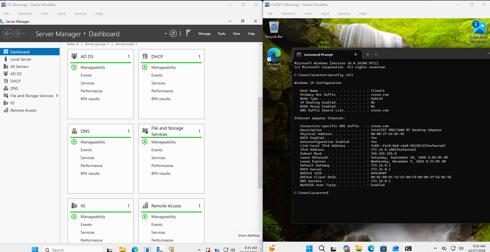
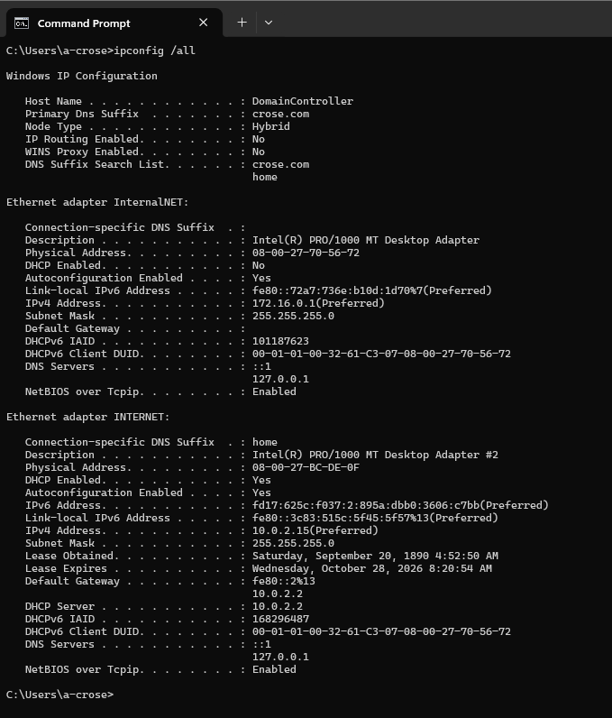
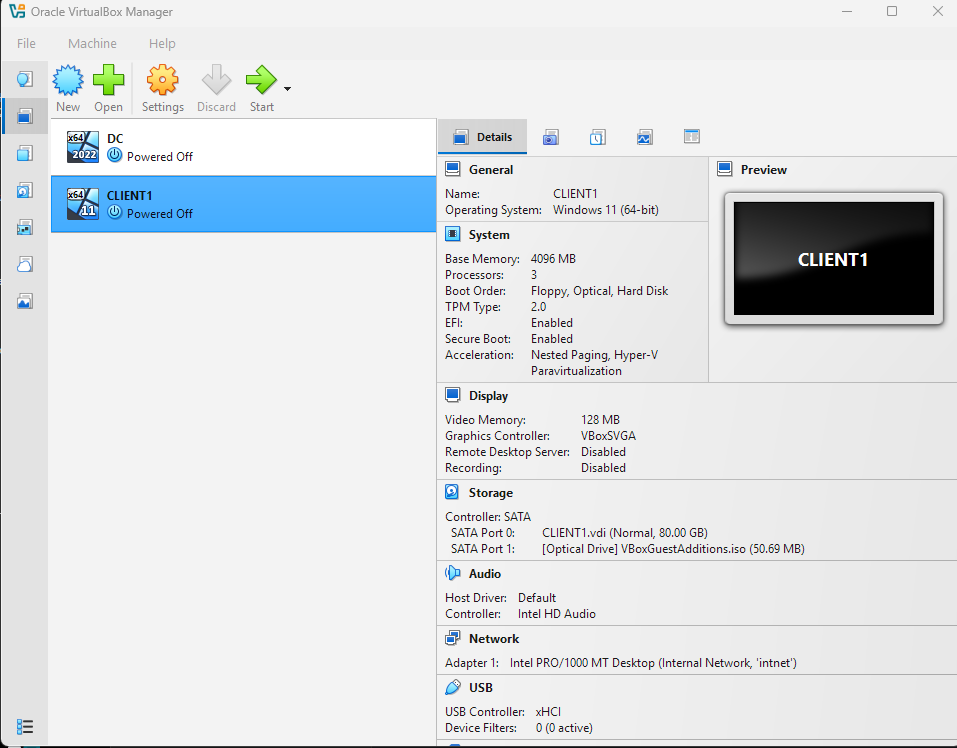
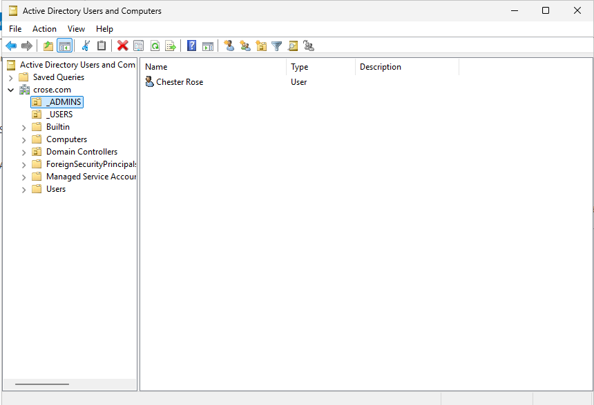
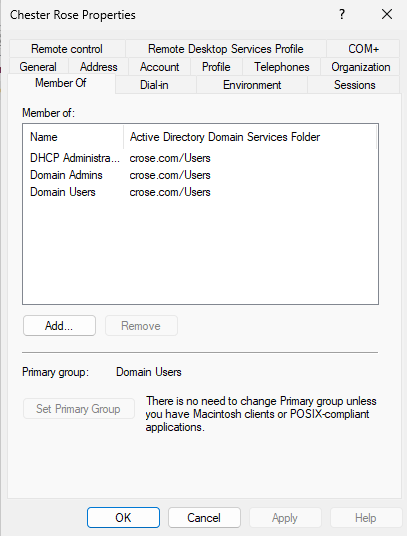
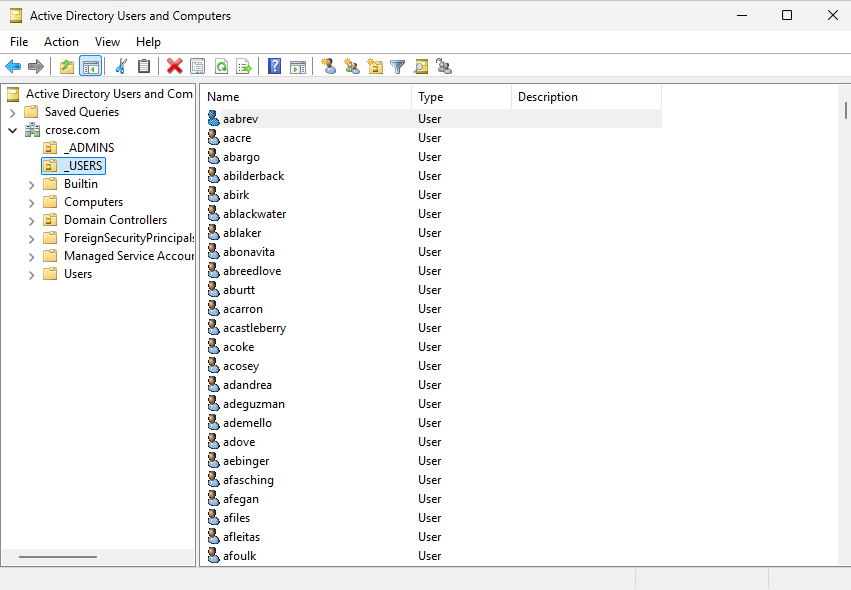
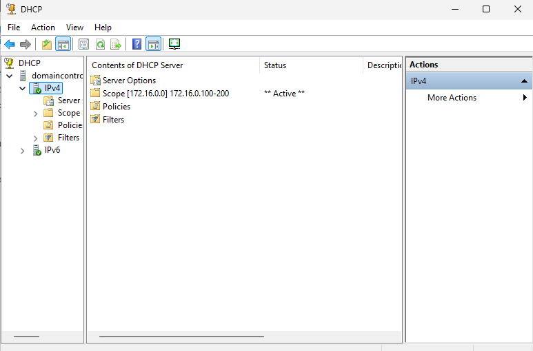
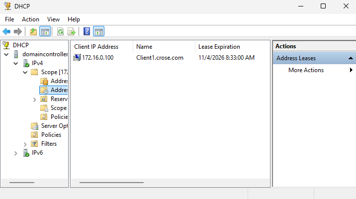

# Infrastructure Build

## Objective

Build a domain environment to practice Windows Server administration and support tasks.

## 

## 

## Topology

!\[Topology](../diagrams/homelab-topology.png)

|VM|Role|IP|Notes|
|-|-|-|-|
|DC01|Domain Controller, DNS, DHCP|172.16.0.1|Static|
|CLIENT01|Domain-joined client|172.16.0.100|DHCP|

## 

## Build Steps (high level)

1. Created internal network in VirtualBox named `intnet`.
2. Installed Windows Server 2019, renamed to DC01, set static IP 172.16.0.1.
3. Installed AD DS role, promoted to Domain Controller for `homelab.local`.
4. Installed and configured DNS (forward and reverse zones).
5. Installed and configured DHCP with scope 172.16.0.100–172.16.0.200.
6. Created Windows 10 VM, attached to `intnet`, joined to domain.

## 

## Troubleshooting

See [troubleshooting.md](troubleshooting.md) for issues encountered and fixes.

## 

## Validation \& Screenshots

### 1\. The Complete Environment

<table>
  <tr>
    <td width="100%" align="center">
      
    </td>
  </tr>
  <tr>
    <td width="100%">
      <b>End-to-End Validation</b> 
      The Domain Controller (left) shows all core roles healthy (AD DS, DHCP, DNS). The Client (right) successfully received a DHCP lease (<code>172.16.0.100</code>) and is using the DC as its DNS server (<code>172.16.0.1</code>).
    </td>
  </tr>
</table>

 

### 2\. Domain Controller \& Virtualization Configuration

<table>
  <tr>
    <td width="50%" align="center" valign="top">
      
    </td>
    <td width="50%" align="center" valign="top">
      
    </td>
  </tr>
  <tr>
    <td width="50%" valign="top">
      <b>Static IP - DNS Loopback</b> 
      The DC is configured with a static IP (<code>172.16.0.1</code>). Its DNS points to loopback (<code>127.0.0.1</code>), and it has dual adapters (Internal + NAT).
    </td>
    <td width="50%" valign="top">
      <b>Virtualization Layer</b> 
      The Windows 11 Client VM is configured to connect to the isolated <code>intnet</code> Internal Network, forcing it to rely on the DC for network services.
    </td>
  </tr>
</table>

 

### 3\. Active Directory Structure \& Security

<table>
  <tr>
    <td width="33%" align="center" valign="top">
      
    </td>
    <td width="33%" align="center" valign="top">
      
    </td>
    <td width="33%" align="center" valign="top">
      
    </td>
  </tr>
  <tr>
    <td width="33%" valign="top">
      <b>OU Structure</b> 
      Custom Organizational Units (<code>\_ADMINS</code>, <code>\_USERS</code>) created to separate administrative accounts from standard users.
    </td>
    <td width="33%" valign="top">
      <b>Privilege Assignment</b> 
      Verified that the dedicated admin account (Chester Rose) has the appropriate Domain Admin group memberships.
    </td>
    <td width="33%" valign="top">
      <b>Bulk User Creation</b> 
      Utilized PowerShell to automate the creation of dummy users into the <code>\_USERS</code> OU for testing scale.
    </td>
  </tr>
</table>

 

### 4\. DHCP Services

<table>
  <tr>
    <td width="50%" align="center" valign="top">
      
    </td>
    <td width="50%" align="center" valign="top">
      
    </td>
  </tr>
  <tr>
    <td width="50%" valign="top">
      <b>Active DHCP Scope</b> 
      Configured the address pool (<code>172.16.0.100-200</code>) and activated the scope on the server.
    </td>
    <td width="50%" valign="top">
      <b>Active Address Lease</b> 
      Verified that <code>CLIENT01</code> successfully negotiated a lease from the DHCP server.
    </td>
  </tr>
</table> 

